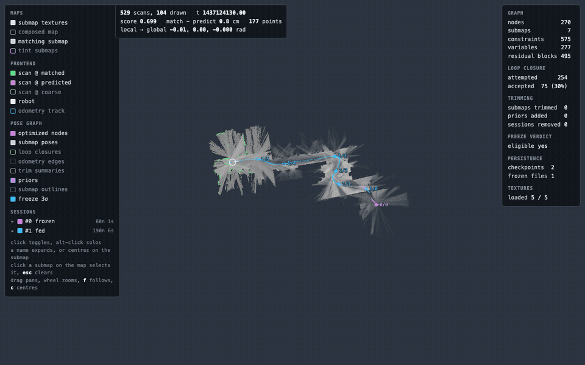
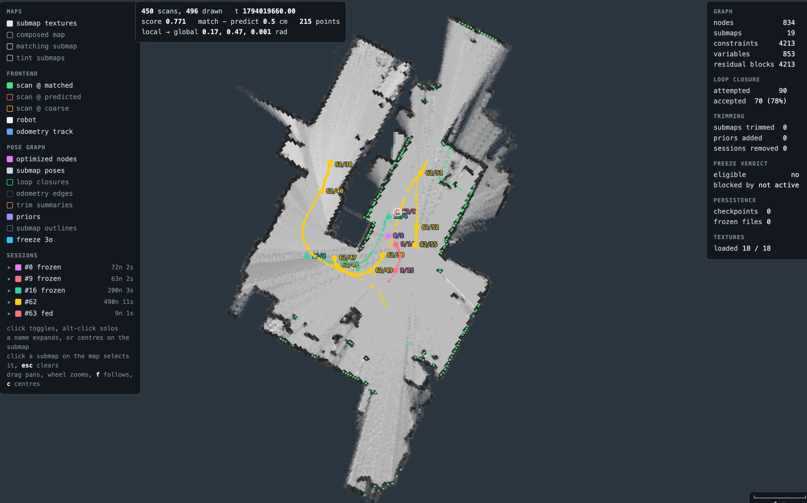
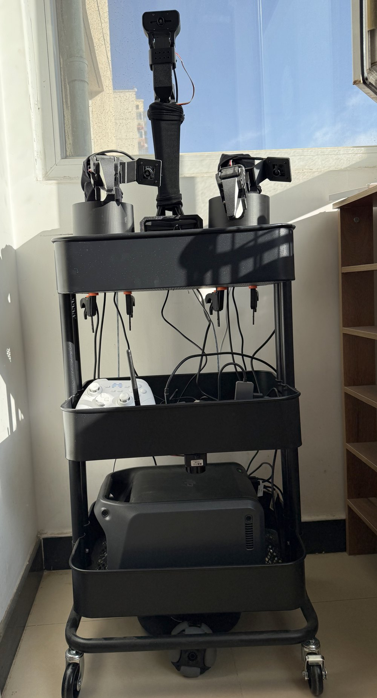
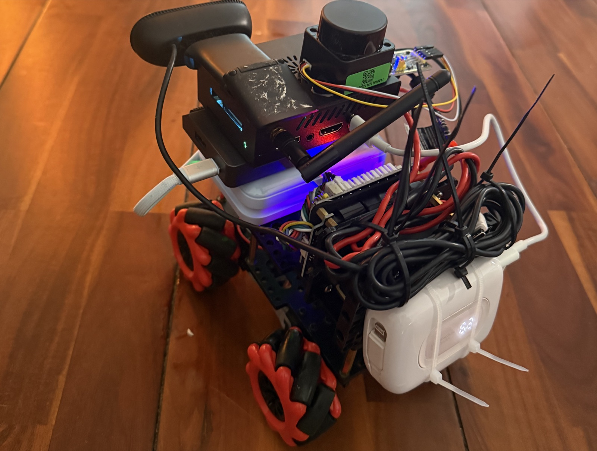

# EvergreenSLAM

EvergreenSLAM is an always-on, hands-off, agent-friendly 2D lidar SLAM, built to serve as the
long-term spatial memory of an agent.

[](https://github.com/ThomasZB/EvergreenSLAM/actions/workflows/ci.yml)
[](https://doi.org/10.5281/zenodo.24028821)

English | [中文](docs/README.zh.md)

---

https://github.com/user-attachments/assets/ecc5e8f2-d290-4b70-8356-79e4789ae43c

<p align="center"><sub>An agent (Claude Code) using EvergreenSLAM as the memory of a home robot; 1:44, wall clock and playback speed on screen. Day 1, from an empty map: asked for the balcony, it finds it through one line of its own exploration notes. Day 2, after a night powered off: a new session with no chat history finds the scissors from memory. No teleoperation, no mapping or localization by hand. Full video (3:18): <a href="https://youtu.be/FXoj2yCrbuo">YouTube</a> (English subtitles), <a href="https://www.bilibili.com/video/BV1M2xW6JEDT">Bilibili</a> (Chinese subtitles); details under <a href="#the-full-exploration-demo">Experiments</a>.</sub></p>

## Features

- **Always-on lifelong SLAM.** Maps are created, frozen and extended automatically, and survive
  any number of power cycles. Nobody has to think about mapping or localization.
- **A CLI.** One command-line tool for driving and debugging the system from a terminal.
- **Agent friendly.** An Agent Skill and an MCP interface let an agent call the SLAM directly.
- **Saved places.** A place is saved through the CLI; the SLAM owns its coordinates and keeps them
  current through every pose-graph optimization. Nobody has to think about coordinates.
- **A spatial memory as a directory tree.** Memory lives in plain files, so an agent reads it the
  way it reads any other memory, with `grep`, `cat` and `ls`.
- **Visualization.** Tools for looking at the map and the localization result.
- **Light and cheap.** C++, few dependencies, a simple build and a small footprint: a 2D lidar for
  about 30 USD and a low-power single-board computer are enough.

To see how the lifelong SLAM is designed, read [Lifelong SLAM](#lifelong-slam). If SLAM is not your
interest, skip to [Agent spatial memory](#agent-spatial-memory) for how EvergreenSLAM serves as an
agent's memory, to [Experiments](#experiments) for what it does on a real robot, or to
[Building and running](#building-and-running) to try it.

## Lifelong SLAM

<p align="center">
  
  <br>
  <sub><code>pixi run -e ros demo</code>: Cartographer's public revo_lds bag (a Neato Revo LDS, 16 min of
  driving) replayed at 8x in the browser debug view. Sessions #0 and #1 freeze in turn and #2 starts
  mapping.</sub>
</p>

### Design

Lifelong SLAM is a mature research direction with plenty of recent papers, but there is no
open-source 2D lidar lifelong SLAM that is hands-off and usable as is. EvergreenSLAM is meant to
fill that gap. Like most lifelong SLAM systems in the literature, it has these properties:

- **Multiple sessions.** Every run is a new session (trajectory). Sessions are frozen, idle or
  current; a frozen session is never modified.
- **Bounded growth.** The system measures how much of each submap in the idle and current sessions
  is covered by newer ones; a submap covered beyond a threshold is deleted, so the map cannot grow
  without bound.
- **History is kept.** A deleted submap is marginalized rather than dropped, and the result is
  sparsified into a Chow-Liu tree to avoid fill-in.
- **Pose-graph optimization.** The poses of the unfrozen sessions are optimized together with their
  constraints to the frozen ones; frozen poses stay constant.

For long-running operation there is also a garbage collector. A session with no constraint to any
frozen session is called *floating*; at startup, a floating session last used more than five
boots ago is deleted (`gc_unfrozen_after_n_boots`, 0 disables it).

> The flow follows some of the classic lifelong SLAM work, for example:
>
> - [Information-theoretic compression of pose graphs for laser-based SLAM](https://dl.acm.org/doi/10.1177/0278364912455072)
> - [A General Framework for Lifelong Localization and Mapping in Changing Environment](https://arxiv.org/abs/2111.10946)
>
> A proper design write-up with a system diagram is planned when time allows; until then, the
> source is the documentation.

### Mapping, localization and extension, managed automatically

<p align="center">
  
  <br>
  <sub>A long run in the browser debug view: 63 sessions created so far, 5 present, 3 of them frozen.</sub>
</p>

On top of the lifelong properties, and so that it can sit in the background without anyone
thinking about mapping or localization, EvergreenSLAM freezes and extends the map by itself. The
current map is frozen and a new session opened when:

- **The first submap finishes.** The first submap's pose is always (0, 0, 0). When it finishes,
  the current session is frozen and a new one opened; this is the reference every later freeze is
  judged against.
- **The extension conditions are met.** Every freeze after the first is a *map extension*. Once
  the session is linked to a frozen session, it freezes when:
  1. the new area exceeds 10% of the existing map, or 200 m²;
  2. seven consecutive submaps add no new area;
  3. the marginal standard deviation of every finished submap's pose is below a per-axis threshold.

Strictly speaking, EvergreenSLAM offers no *mapping*, *extension* or *localization* in the usual
sense, only the automatic management described above. Its purpose is to keep localization stable
over the long run instead of drifting with every update. In a highly dynamic environment it can
be switched off with `auto_freeze`; EvergreenSLAM is then a typical lifelong SLAM with no fixed
anchor, and the map may drift as it updates, but saved places drift with the pose graph, so the
robot can still return to them.

For anyone who wants an agent or a person to manage mapping, extension and localization, the
commands exist: `egs session freeze` freezes by hand, `egs map new/open` creates or switches maps,
`egs init-pose` and `egs relocalize` relocalize by hand. Used that way, they behave like the
mapping, extension and localization of a conventional SLAM.

### Relocalization

At every start the new session begins at the last saved pose and aligns itself to the frozen map
through loop closures; no relocalization by hand is needed.

If no loop closure ever links the session to the frozen map, the current session carries on from
its starting pose. `egs relocalize` then triggers a global relocalization: it runs a
branch-and-bound search over every frozen submap, one by one, which takes a while; a faster
version is planned.

`egs init-pose` relocalizes around a given pose: a branch-and-bound search within 2 m, much
faster. Internally the newest keyframe gets the pose as a loop-closure seed. Even when the search
produces no closure, a floating session is moved as a whole onto the best weak match (or onto the
given pose when there is none), which `egs` reports as `reseeded`; a session already linked to the
frozen map is never moved this way.

## Agent spatial memory

With the automatic management above, EvergreenSLAM can serve as an always-on spatial memory for an
agent. The memory is a directory tree: everything lives as plain files under `memory/`, which the
agent reads and edits through `egs fs ls|tree|cat|grep` (or straight from the shell when the SLAM
runs on the same machine). A command-line tool and an Agent Skill cover what the files cannot:
saving a place, asking where one is, recording an observation. The main points:

- **A place is an anchor.** `egs place save places/kitchen` stores the robot's pose as an anchor,
  bound by ID to a submap of the pose graph. After re-optimization, trimming, freezing or a
  restart, the place moves with its submap, and `egs where` always answers with the current
  position.
- **Memory is a directory.** Directories are places and things; the path is containment:
  `places/kitchen/table/apple` is the apple on the kitchen table. The agent decides what deserves
  a place and what goes into the files below it.
- **A place is a workspace.** A place directory can hold `notes.md` (free notes) and `SKILL.md`
  (what to know here, say how to dock); a thing has an append-only `observations.jsonl` (seen,
  absent, could not check) and photo attachments.
- **Search like any memory.** `egs fs ls|tree|cat|grep|write|mv|rm` work on the tree, `egs find
  scissors` ranks things by name, alias and kind, `egs fs grep balcony` searches every note.
- **A view to check on.** `egs view` renders the map and the localization result as an image; its
  parameters choose what to draw, much like rviz.
- **Command and process are separate.** `egs` depends on the Python standard library only and
  talks HTTP to the agent service inside the SLAM process (`127.0.0.1:8643`); an agent on another
  machine connects through an SSH tunnel. Agents that take tools rather than a shell use `egs mcp`
  (MCP over stdio, one tool per command).

`egs help agent` lists the commands in under 30 lines. The directory conventions are in
[memory_README.md](adapters/agent/memory_README.md), the Agent Skill in
[SKILL.md](adapters/agent/skills/evergreenslam/SKILL.md), the HTTP contract in
[API.md](adapters/agent/API.md).

### The CLI

`egs` was made for agents, but it is just as handy for a person driving and debugging the system.
Some everyday commands:

```bash
egs --help                        # help
egs root                          # where memory/ lives and which map is open
egs here                          # the robot's pose
egs relocalize                    # global relocalization
egs init-pose --place places/<p>  # relocalize around a given pose
egs map ls|new|open               # maps: list, create, switch
```

## Experiments

As of 2026-11-07, EvergreenSLAM has run on my home robot for half a month without trouble. I use
it mostly while developing my robot harness, and the agent has handled every place-related task I
gave it, such as the ones I ask for all the time:

- go to the debugging spot
- back to the rest spot
- go where you charge

These tasks are simple. A conventional SLAM gets there too: build the map, switch to localization,
save the station coordinates, and let the agent call a tool. The difference with EvergreenSLAM is
that nobody touches any of that. From the first boot the robot is run in natural language alone,
and a few words in passing (for instance "nothing else to do, just wait here") are enough for the
agent to save a place itself. There is no mapping-localization-station workflow; the agent needs
no knowledge of SLAM, not even that a SLAM is running. Through `egs` it remembers a pose without
remembering a coordinate, and later finds it again by asking in natural language.

> The memory this gives the harness is far better than I expected. In the harness I am building, a
> background worker takes care of place memory (it takes photos and records whatever is worth
> keeping through `egs`). The robot explores my home on its own or follows me around once, and in
> later conversations the agent queries these place memories in natural language, as naturally as
> any other memory. In one exploration run I never named a single place. Afterwards I asked the
> agent to photograph the balcony. `egs find 阳台` (balcony) found no such place; `egs fs grep
> balcony` then found it on line 7 of `places/living-room/notes.md`, saved as
> `a red striped curtain and, past it, a glass door to what looks like a balcony (阳台, inferred)`.
> `egs` makes spatial memory as easy to query as ordinary memory: the agent needs one keyword, no
> coordinate, and no idea whether a SLAM is running.

### The full exploration demo

<p align="center">
  
  <br>
  <sub>The platform the demo ran on: an XLeRobot (three omni wheels, a head camera on a pan/tilt neck, two SO-101 arms, not used) with the same 2D lidar as the car below and an RK3588 board. EvergreenSLAM uses only the lidar and the board.</sub>
</p>

<p align="center">
  <a href="https://youtu.be/FXoj2yCrbuo"></a>
  <br>
  <sub>Full video (3:18, English subtitles) on YouTube; Chinese subtitles on <a href="https://www.bilibili.com/video/BV1M2xW6JEDT">Bilibili</a>.</sub>
</p>

**The demo:**

1. Start EvergreenSLAM on a fresh, empty map.
2. Start Claude Code (Opus 5.5) in the RobbyBot project (another project of mine, not public yet)
   and load the skills.
3. Have the robot follow me and save a rest spot beside the fridge.
4. Let the robot explore on its own; the agent saves several places through `egs`.
5. Ask it to find the scissors. Through `egs` the agent reviews the places it just saved (the
   desk, the shelves), checks the likely ones in turn, and finds the scissors on a table.
6. Ask it to photograph the balcony and return to the rest spot. The agent finds the balcony
   through `egs`, takes and saves the photo, and returns.
7. Next day, reboot the robot and ask for the scissors again. The agent learns from `egs` that
   they are on the table, goes to confirm, returns to the rest spot and appends an observation.

> During this run the robot asked me several times over Telegram; I told it to keep looking by
> itself and hinted that scissors usually sit on a table. In the two earlier takes before the one
> on video it never asked and found the scissors within a single conversation.

**What the agent did** (times as shown at the top left of the video; only what passed between
the agent and `egs`):

1. **Start (17:03).** `egs root`, `egs fs cat README.md`, `egs here`, `egs fs tree places`: a
   fresh map, no places.
2. **Rest spot (17:03–17:06).** `egs place save places/rest-spot`, then `node.yaml` (aliases) and
   `notes.md`, noting that a person chose it.
3. **Exploring alone (17:06–17:12).** Picks unvisited areas from `egs view map`, looks around with
   the camera on arrival, saves the figure shelf, the living room, the washing machine, the desk
   and the bedroom, and marks in each note where the information came from (seen, told,
   inferred). At 17:08 the living-room note gains one inferred line: the glass door behind the
   curtain looks like it leads to a balcony. The balcony is neither visited nor saved.
4. **Writing its own rule for a place (17:13).** Returning to the rest spot, Nav2 creeps back and
   forth over the last centimetres; the agent finishes with short moves of its own and writes
   `places/rest-spot/SKILL.md` (fridge panel squarely behind, rear lidar reading 0.43–0.45 m).
   From then on `egs where places/rest-spot` lists it under `read first:`.
5. **Finding the scissors (17:12–17:23).** `egs find 剪刀` and `egs fs grep scissors` return
   nothing. The object detector has gone down by now, so the agent reads the snapshots itself. It
   checks the desk, the tool shelf (saved as `tool-shelf`), the hallway and bedroom side tables in
   turn, appending each "not found" to that place's `notes.md`; my hint that scissors usually sit
   on a table goes into `places/notes.md`. It finds them on a small side table that exploration
   had missed: `egs place save places/side-table`, then
   `egs observe places/side-table/scissors --offset …`.
6. **A photo of the balcony (17:23–17:25).** `egs find 阳台` returns nothing; `egs fs grep balcony`
   returns the inferred line from step 3. The agent drives to the tool shelf, turns its head to
   the curtain, goes in, saves `places/balcony` (alias 阳台) and sends the photo. 102 seconds from
   request to photo, and I said nothing in between.
7. **Back to the rest spot (17:25–17:26).** Docks by its own `SKILL.md`.
8. **The next morning (09:39–09:43).** Powered off overnight where it stood (not moved). After
   boot, with no relocalization by hand, `egs here` reports `places/rest-spot` straight away. A new
   session with no chat history is asked whether it remembers where the scissors are: `egs find
   剪刀` returns `places/side-table/scissors`, seen 16 hours ago; the agent drives to the approach
   pose from `egs where` to check, sends the photo 44 seconds after reading the question and
   appends a new observation with `egs observe`. Back at the rest spot it docks by the previous
   day's `SKILL.md` again.

At the end of day 1, `memory/` holds 12 places, one thing, one place rule and one house-wide
note, all plain files. `egs` is memory only: Nav2 drives, and the agent listens, looks and
decides with the harness's tools. There was no teleoperation at any point.

### An earlier experiment on an ultra-low-cost platform

<p align="center">
  
  <br>
  <sub>The first test platform: a 2D lidar (215 CNY, about 30 USD), an RK3588 Orange Pi, mecanum wheels, two power banks.</sub>
</p>

At the start of the project I put together this very cheap test platform at my parents' home and
did the first deployment and validation on it. It stays here to show that the project deploys
quickly on hardware this modest; I no longer use the car, and every later experiment ran on the
XLeRobot above.

## Building and running

Core alone, no ROS:

```bash
cmake -S core -B build -DEVERGREENSLAM_BUILD_TESTS=ON && cmake --build build -j8 && ctest --test-dir build
```

Dependencies: Eigen, Ceres, glog, yaml-cpp, protobuf (library and `protoc`), OpenMP, gtest.

```bash
# macOS
brew install eigen ceres-solver glog yaml-cpp protobuf libomp googletest
# Ubuntu 24.04 (core links yaml-cpp 0.8; 22.04's package is too old)
sudo apt install libeigen3-dev libceres-dev libgoogle-glog-dev libyaml-cpp-dev \
                 libprotobuf-dev protobuf-compiler libgtest-dev
```

Or let [pixi](https://pixi.sh) fetch everything including ROS 2 Jazzy and rviz2 (macOS Apple
Silicon and Linux; the header of `pixi.toml` lists every task):

```bash
pixi run core-test                      # core alone
pixi run agent-test                     # agent service and egs
pixi run -e ros ros-test                # ROS 2 adapter
SCAN_TOPIC=/base_scan BASE_FRAME=base_footprint pixi run -e ros bag bags/wg_cafe   # replay, browser view at http://localhost:8642
pixi run -e ros live                    # live node: /scan in, map, tf and the agent service out
pixi run -e ros demo                    # fetch a 3 MB public bag, replay it with the browser view and egs
```

`live` expects a lidar driver publishing `sensor_msgs/LaserScan` on `/scan` (`SCAN_TOPIC` changes
it) and a TF from `base_link` to the laser frame when the two differ. It always publishes `/odom`
from laser odometry (without covariance), and with `publish_tf` both the odom to base_link and the
map to odom transforms; if the base driver already publishes odom to base_link, switch that one
off, because `publish_tf=false` drops map to odom as well, and remap one of the two `/odom`
topics. Start from `configs/evergreenslam.yaml`; the museum and carmen configs are for the museum
and CARMEN datasets. Maps persist under `runs/maps` with pixi (`MAP_ROOT` changes it; `bag`
persists only when `MAP_ROOT` is set). pixi builds for osx-arm64 and linux-64; on a Linux ARM
board use the system packages or colcon. Tested on ROS 2 Jazzy.

The repository is also a plain colcon workspace source: clone it into any `ws/src`, then
`rosdep install --from-paths src --ignore-src -y && colcon build`. Docker Compose wraps the same
targets for Linux (`docker compose run --rm core-test`).

On a board without a real-time clock, start the node after time synchronization: order its
systemd unit `After=time-sync.target` with `Wants=time-sync.target`, and enable the wait service
of the time daemon (`chrony-wait.service` or `systemd-time-wait-sync.service`). A scan timestamp
that moves backwards, or forwards by more than `max_scan_gap_seconds` (60 s by default), is
treated as a clock step: the node saves the map and exits with a non-zero status, and on restart
re-aligns from the last saved pose. It therefore needs a supervisor, either `Restart=on-failure`
in systemd or `respawn` in ROS 2 launch (`evergreenslam.launch.py` sets it). The replay tool stops
with an error in the same situation.

### Data

No data ships with the repository. Most public 2D lidar bags are ROS 1; two scripts convert them
without a ROS install:

```bash
pip install rosbags
curl -O http://download.ros.org/data/graph_slam/wg-cafe.bag
python3 tools/convert_ros1_bag.py wg-cafe.bag bags/wg_cafe
SCAN_TOPIC=/base_scan BASE_FRAME=base_footprint EXTRA="--speed 4" pixi run -e ros bag bags/wg_cafe
```

Replay is paced to real time when the browser view is on; `EXTRA="--speed 4"` runs it faster.
The agent service is on during replay only with `MAP_ROOT` set and `EXTRA="--agent_port 8643"`.

The classic datasets (Intel Research Lab, ACES, MIT Killian Court) come as CARMEN logs from the
[Freiburg SLAM evaluation page](http://ais.informatik.uni-freiburg.de/slamevaluation/datasets.php);
`tools/convert_carmen_log.py` turns a `.clf` into a bag. How the replay tool scores the result
against the reference trajectory is described in
[`adapters/ros2/evergreenslam_ros/README.md`](adapters/ros2/evergreenslam_ros/README.md).

### The agent interface

With the live node running, the agent service listens on `127.0.0.1:8643` and `egs` is the
client:

```bash
export PATH="$PWD/adapters/agent/egs/bin:$PATH"
egs help agent                     # the rules and the command table, under 30 lines
egs here                           # where the robot is
egs status                         # map health: frozen base, alignment, closures
egs place save places/kitchen/door # remember the spot it stands at
egs where places/kitchen/door      # pose, precision, and the pose to approach it from
egs view here                      # scan over the map, around the robot
```

`egs` is Python 3.9+ with no dependencies; `pipx install ./adapters/agent/egs` installs it on a
machine without ROS, and `egs skill install <skills dir>` gives an agent the skill. Its first
section is the onboarding (`egs root`, read `memory/README.md` with `egs fs cat`, read the
`SKILL.md` chain down to the place). For agents that take tools rather than a shell, `egs mcp`
serves the same commands as MCP tools over stdio, generated from the CLI and one to one with it.
The service binds `127.0.0.1`; an agent on another machine reaches it through an SSH tunnel
(`ssh -NT -L 127.0.0.1:8643:127.0.0.1:8643 user@robot`), with
connection settings in `~/.config/egs/config` ([`adapters/agent/egs/README.md`](adapters/agent/egs/README.md)). The HTTP
contract is [`adapters/agent/API.md`](adapters/agent/API.md), the skill is
[`adapters/agent/skills/evergreenslam/SKILL.md`](adapters/agent/skills/evergreenslam/SKILL.md).

### Layout

```
core/            the SLAM, no ROS: sensor / mapping / lifelong (pose graph, sessions, persistence) / utils
adapters/ros2/   three ament packages: msgs, the node and bag tool, the rviz2 plugin
adapters/agent/  the agent service (HTTP), the egs CLI and the agent skill
apps/webui/      the browser debug view
configs/         yaml configs; configs/reference.yaml lists every key
tools/           bag converters, the TSan gate and the demo
```

## Related work and acknowledgements

- [Cartographer](https://github.com/cartographer-project/cartographer) (Hess et al., 2016;
  Apache 2.0). The correlative scan matchers, the precomputation grids, the probability-grid
  submaps, the voxel and motion filters and the constraint builder follow its design, and the
  rviz2 submap display is ported from `cartographer_rviz`. See `NOTICE`.
  `core/src/utils/scan_matching` is the closest to the original. Cartographer has no sessions,
  freezing or marginalizing trimmer; those are this project's.
- [slam_toolbox](https://github.com/SteveMacenski/slam_toolbox) (Macenski and Jambrecic, 2021),
  the 2D lidar SLAM supported by Nav2. The user picks its mode by node and configuration: mapping
  (synchronous or asynchronous), continued mapping of a serialized pose graph, and localization
  against one with a rolling window of recent scans; an experimental node switches between
  mapping and localization through a service call. Nodes are removed in two places, both through
  `Mapper::RemoveNodeFromGraph`, which deletes a node and its edges without marginalizing them:
  localization drops its expired scans, and a lifelong node in `src/experimental/`, described by
  its README as highly experimental, drops nearby map nodes that score low against each new scan.
  It requires an odom-to-base transform in TF: scans without one are dropped, and its
  minimum-travel gate is measured in that frame. EvergreenSLAM has no mapping/localization split,
  decides by itself when a session freezes, marginalizes what it trims, and needs no odometry
  source. slam_toolbox has a scan matcher (Karto) that its README describes as used in companies
  across the world, Nav2 integration, multi-robot mapping, map merging and interactive graph
  editing in rviz. Checked against its `ros2` branch at commit 6efdc33 (2026-10-15).
- The trimmer's marginalization and Chow-Liu sparsification follow the pose-graph compression
  literature, in the spirit of Kretzschmar and Stachniss (2012).
- [Claude Code](https://claude.com/claude-code). Most of the code was written with Claude, under
  the author's design, review and testing.
- [cpp-httplib](https://github.com/yhirose/cpp-httplib) (MIT) and
  [stb_image_write](https://github.com/nothings/stb) (public domain), vendored in `third_party/`.
- [RoboStack](https://robostack.github.io/), which puts ROS 2 inside pixi and makes the macOS
  workflow possible.
- The Freiburg and Willow Garage datasets, used for replay and scoring, and Cartographer's
  revo_lds bag, used for the demo.

## Citation

If EvergreenSLAM is useful in your work, please cite it. GitHub's "Cite this repository" button
reads [`CITATION.cff`](CITATION.cff).

```bibtex
@software{chen2026evergreenslam,
  author  = {Chen, Hang},
  title   = {EvergreenSLAM: always-on 2D lidar SLAM as the long-term spatial memory of an agent},
  year    = {2026},
  version = {0.3.1-preview},
  doi     = {10.5281/zenodo.24028821},
  url     = {https://github.com/ThomasZB/EvergreenSLAM}
}
```

## License

Apache License 2.0. See [`LICENSE`](LICENSE) and [`NOTICE`](NOTICE).
