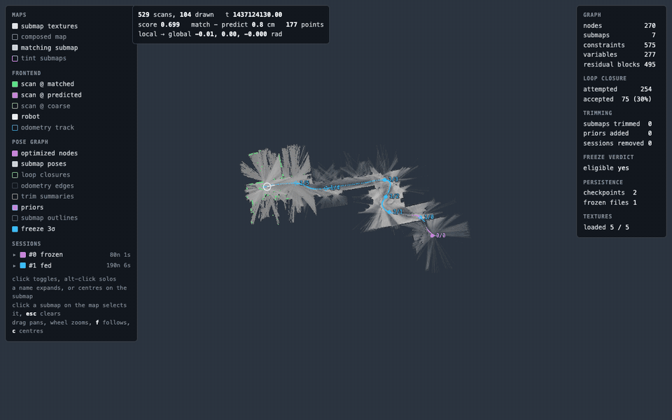
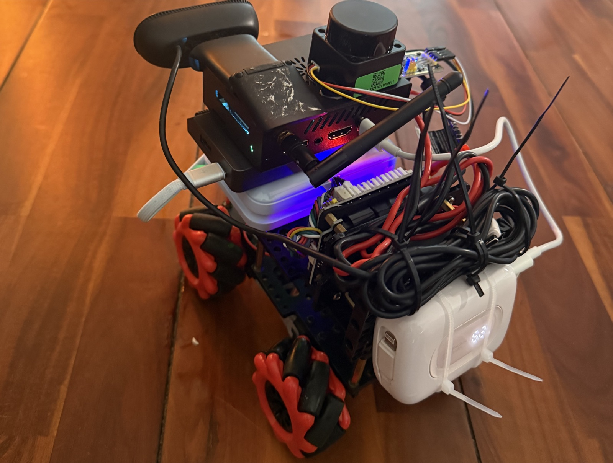
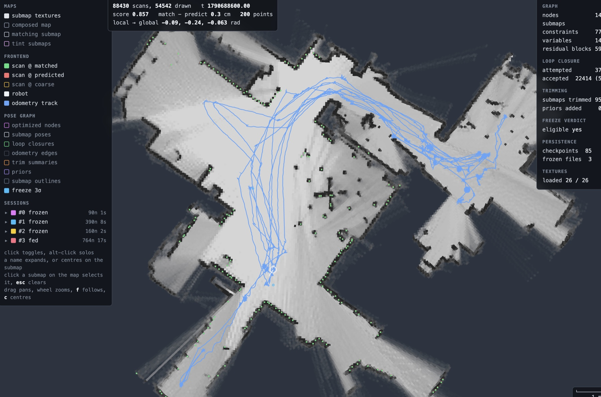
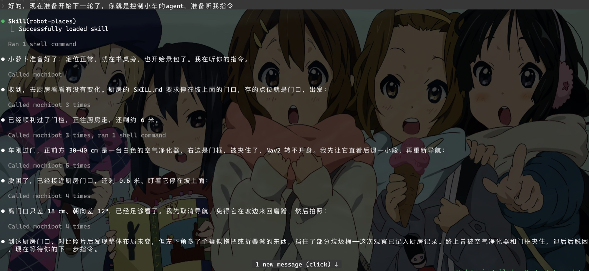

# EvergreenSLAM

常驻运行的 2D 激光 SLAM，支持命名地点，用作 LLM agent 的空间记忆。

[](https://github.com/ThomasZB/EvergreenSLAM/actions/workflows/ci.yml)

[English](../README.md) | 中文

---

## Hello, world

```
$ egs here
current places/dock 2.4m
closest places/dock 2.4m frozen; places/kitchen 15.3m frozen
robot 0.48,1.02,-2.72  keyframe 0s  @solve 135
base 0.75 (cover 98%)  since base match 0.0m  match 0.70 (avg 0.70)
```

<p align="center">
  
  <br>
  <sub><code>pixi run -e ros demo</code>：Cartographer 公开的 revo_lds 数据包（Neato 扫地机上的 Revo LDS 雷达，约 16 分钟）在浏览器调试视图中 8 倍速回放。session #0 和 #1 先后冻结，随后 #2 开始建图。</sub>
</p>

让 agent 去冰箱拿一瓶可乐，它听得懂要做什么，却不了解这个家：冰箱在哪、厨房怎么走、可乐上次放在哪。无论用哪个模型，agent 都需要空间记忆：能根据一句命令、一段文字或一张照片记住一个地点，之后让机器人回到那里，并且这份记忆在上下文压缩、地图重新优化和进程重启之后依然有效。EvergreenSLAM 是围绕这个需求设计的 2D 激光 SLAM。

- **单一模式，无需人工操作。** 系统作为后台进程常驻，不区分建图模式和定位模式：始终在当前 *session* 中建图，同时在已*冻结*的 session 上定位；一个 session 新增的区域足够多、位姿约束足够好之后，会自动冻结。
- **资源随面积增长，不随运行时长增长。** 删减时对被删部分做边缘化，再将结果稀疏化为 Chow-Liu 树；冻结位姿在优化中保持为常量。因此内存和 CPU 的上界由建图面积决定，与运行时长无关。
- **地点长期有效。** 地点是*锚点*，绑定在位姿图的子图上，而不是坐标上；agent 通过一棵目录树和一个小 CLI（`egs`，也提供 MCP 工具）来使用。
- **只需一颗廉价雷达。** 一颗 2D 雷达加 CPU 即可，不需要 IMU、轮式里程计、相机或 GPU。已在 215 元的雷达和 RK3588 板子上做过实机测试，也在公开 2D 数据集上测试过。

扫描匹配和子图沿用 Cartographer 的设计，其上的 lifelong 层由本项目实现。与 slam_toolbox 的对比见「相关工作与致谢」。

<p align="center">
  
  <br>
  <sub>测试平台：一颗 2D 雷达（215 元，约 30 美元），一块 RK3588 的 Orange Pi，麦轮，两个充电宝。</sub>
</p>

## 动机

**agent 不了解这个家。** 语言理解已经不是瓶颈：让 agent 去冰箱拿可乐，它明白要做什么，缺的是这个家的布局。agent 的记忆是文本，把布局描述到足以据此行动的程度，要占用大量上下文，而且只在上下文存续期间有效，也经不住上下文压缩。

**坐标很脆弱。** 用地图坐标记录地点维持不了多久：地图重建或重新优化后坐标就会失效，agent 往往察觉不到；换一张地图，坐标就毫无意义。基于常规 SLAM 的 agent 都得自己维护一套「东西在哪」的记录，还要让它和地图保持一致。agent 需要的是一个始终指向同一物理位置的*名字*，以及一个记录在那里所见内容的地方。

**无人值守的 SLAM。** 常见的 SLAM 流程是：调里程计、标定外参、同步时间戳，开着车建图，存图，切到定位模式，环境变了调参，变多了重建。厂家通常会把这套流程封装好，或者培训客户；新手一旦哪一步出错，地图就会出现重影或漂移，有时到后面才发现，而重建意味着所有站点都要重新配置。每一步都需要人来操作，而 agent 不应该被迫充当这个操作员。

**设想的使用方式。** 例如：带着机器人在家里走一圈，到厨房时说「这里是厨房」，到书桌时说「这是书桌」，此外不再处理任何建图或定位的事。第二天说「去厨房看看」，它就知道怎么去。agent 记下剪刀在书桌左边的抽屉里、苹果在餐桌上，几天后问「剪刀在哪」，它能找到对应的地点。家具挪了、地图重新优化了、机器人重启了，这些地点依然有效。拿可乐这件事，也就从「知道冰箱在厨房、知道厨房怎么走」开始，到了再交给机械臂。后面这些步骤还需要机械臂和视觉配合；最底下这一层，即无需人维护地图、始终有效的地点，本项目认为应当由 SLAM 直接提供。

**lifelong SLAM 在哪。** 这些需求的底层就是 lifelong SLAM：一直开着，边用边建，跟随环境变化，资源不随运行时长增长。这个方向的研究文献很多，但据作者所知，能直接拿来使用的开源 2D 实现很少；slam_toolbox 的 lifelong 节点在其 README 中标注为 highly experimental，删除节点时也不做边缘化（见「相关工作与致谢」）。

**成本。** 这份记忆得便宜到可以在小车上一直开着。3D 激光几百美元起步，还得配一块跟得上它数据量的板子。摄像头便宜，但稠密的或基于学习的视觉 SLAM 通常要的算力比一块小板子多，而且摄像头在黑暗、无纹理的墙面和光照变化下会退化。2D 激光两百块钱左右，不需要 GPU，不受光照影响；它自身的失效场景（玻璃、镜子、强光直射）本项目不处理。出于同样的理由，管线不融合 IMU、轮式里程计和摄像头：每多一种传感器就多一套标定、时间同步、驱动和按车调参。代价是运动预测只能依靠激光：一个采用 Singer 运动模型、只以扫描匹配结果为输入的卡尔曼滤波，在快速转弯和缺少特征的长路段上预计表现不佳。本项目的取舍是：廉价的几何信息，加上挂在命名地点上的稀疏语义（比如让视觉语言模型偶尔记一句"垃圾桶在这"），在这个场景下比稠密视觉 SLAM 更划算。

## 工作原理

### session 与冻结

建图以 session 为单位组织。前端始终在当前 session 中建图；后端对可达范围内所有已完成的子图做回环，无论是否冻结，也包括当前 session 自己的子图，而下文的滚动窗口保证这些子图都是最近建的。环境逐渐变化时，机器人匹配的是当前的环境，而这些最近的子图又被约束到冻结的底图上。

第一个 session 有了已完成的子图后即成为冻结的底图。之后的 session 要先在冻结区域之外新建足够多的区域、并且停止增长，才会进入冻结判断；当它与某个已冻结 session 建立了约束，且每张已完成子图位姿的边缘标准差在各轴上都低于阈值时，就会冻结。冻结后，该 session 的文件变为只读，位姿在之后的所有优化中保持为常量。只在已知区域内活动的 session 不会自动冻结（可用 `egs session freeze --yes` 手动冻结）；未冻结的 session 若超过五次启动都没有新数据输入，就会被丢弃（可配置）。session 之间重叠的区域，合成地图取置信度更高的格子。因此，已建区域内的变化在当前 session 存续期间可以看到，但不会被冻结进底图；对变化后的房间重新冻结已在计划中，尚未实现。

<p align="center">
  
  <br>
  <sub>长时间运行时的浏览器调试视图：四个 session，其中三个已冻结。</sub>
</p>

### 重定位

`egs init-pose`（给位姿或已存的地点）和 `egs relocalize` 拿当前 session 最新的一帧扫描，去匹配其他 session 的已完成子图：给了位姿时，取覆盖到它 2 m 以内的子图，角度范围 ±0.5 rad；没给时，取全部子图、全部朝向，逐张做分支定界。匹配得分超过常规阈值才成为回环约束。还没连上冻结 session 的 session，本身的位置没有保留价值，所以没加上约束时，它会被整体移到得分不低于 0.2 的最佳匹配上，没有这样的匹配就移到给定的位姿。之后它仍处于未连接状态，直到有回环通过常规阈值；`egs` 把这种结果报告为 `reseeded`。已连上底图的 session 不会被这样移动。

### 有界增长

两个机制让图不随运行时长增长。

*带稀疏化的删减。* 活动 session 在重复经过的区域只保留自己子图的一个滚动窗口：旧子图的区域已被更新的子图覆盖，或其轨迹已被之后的几趟覆盖时，就会被删除。删除通过边缘化完成，而不是直接丢弃：取被删节点的 Markov 毯，计算保留节点的联合协方差，再将得到的稠密信息稀疏化为一棵 Chow-Liu 树（基于两两互信息的最大生成树），用树的边替换被删除的约束；跨度过大的边转为按边缘协方差加权的先验。冻结时，大部分区域已落在冻结地图内的已完成子图也按同样方式删除；若全部满足条件，则保留一张。

*冻结的 session 是常量。* 冻结位姿在 Ceres 问题中是设为常量的参数块，两张冻结子图之间不建约束，冻结的子图也从不修改。因此优化规模只取决于活动 session，与整张地图无关；冻结部分随建图面积线性增长。仿真中 30 圈的运行保持有界。实机上已在一套住宅里运行过数天，但当时没有记录内存和位姿图规模，数据之后补充。

### 地点即锚点

保存的地点是一个锚点：位姿图中的一张子图加上一个相对变换。图重新优化时，地点随子图一起移动；重启后，名字依然有效。锚点在回环、删减、冻结、重启以及写入中断之后都能保持，`egs where` 查询的就是它。

### 记忆即目录

`memory/places/kitchen/table/apple` 表示某个地点中的一个物体。agent 用 `ls`、`cat`、`mv`、`grep` 操作这棵树。只有运行中的进程才掌握的信息，比如位姿、保存地点、地图和 session 管理，才通过 `egs`。禁区、笔记和各地点的 skill 都在同一棵树里。`egs view here` 把当前扫描叠加在机器人周围的地图上渲染出来，供 agent 自行判断定位是否漂移。

### 实现

纯 2D，全部 `double`，位姿用 `Eigen::Affine2d`。激光里程计用相关性匹配加 Ceres 精修，子图是概率栅格，位姿图用分支定界回环加 Ceres 优化，在此之上是按 session 进行的删减、冻结，以及原子提交的持久化。`core/` 不依赖 ROS，ROS 2 只是其中一个适配器。

## 实机测试

2026-09-29，由 Claude Code 驱动上述平台，在一套住宅中完成了一次任务。agent 使用一个封装了 `egs` 和 Nav2 导航的小工具（`mochibot`），以及一个在本仓库 `evergreenslam` skill 基础上针对这套住宅编写的 skill（`robot-places`）。对话使用中文，各步骤及对应的 `egs` 调用如下：

1. **"你就是控制小车的 agent，准备听我指令。"** 它加载 skill，跑 `egs here`，报告：定位正常，在书桌旁，开始录包。
2. **"去厨房看看有没有变化。"** 它读记忆目录里厨房的 `SKILL.md`，上面写着停在坡上面的门口。存的点位就是门口，`egs where places/kitchen/door` 给出接近位姿，它交给导航。
3. 过了门槛，还剩约 6 米。
4. 刚过门就被夹住：正前方 30 到 40 cm 是空气净化器，右边是门框，Nav2 转不开身。它让车直着后退一小段，重新规划。
5. 脱困，离门口 0.6 米。它确认车停在了坡上。
6. 离存的位姿差 18 cm、12°。它判断已经足够接近，在车开始在坡边来回调整之前取消导航，然后拍照。
7. 跟上次记录的照片对比：布局没变，但左下角多了个东西，疑似拖把或折叠凳，挡住了部分垃圾桶。它用 `egs observe` 写入厨房的记录，然后等待指令。

<p align="center">
  
</p>

驾驶、后退、拍照和对比由封装工具和 Nav2 完成，`egs` 只负责回答位置并保存记录。用户没有输入过任何坐标，位姿由 `egs` 直接传给导航。

测试结束后，让同一个 agent（Claude Code，Opus 5.5 模型）简单评价了截至当时的使用体验；评价范围不限于这一次任务，且早于 v0.2 的功能。概括如下：它在这个平台上从空地图开始，保存了厨房和书桌，之后按名字回去查看变化；重启后，地图和位姿无需干预即可恢复。整个过程几乎只用到 `egs` 命令和一个普通目录，不涉及坐标，也不涉及 ROS 的细节。此后这个平台又在同一套住宅里运行了数天；根据这几天暴露的问题修复之后，agent 没有再卡在定位或地图上。

## 验证与局限

本项目目前是预览版，不是成熟产品。范围限定在核心功能，已知缺项如下。

在 macOS 和 Linux 上测过：单测；前端、扫描匹配器和后端每一级（回环、删减、冻结、持久化、重定位、锚点）的模拟激光端到端测试。每次 push 由 CI 在 Linux（gcc）和 macOS 上跑 core 与 agent 的测试；后端测试的 ThreadSanitizer 和 ROS 2 适配器的构建仍是手动。在上述平台和公开数据包上验证过：激光里程计、回环、多 session 建图与自动冻结和删减、原子提交的持久化和命名地图、agent 服务和 `egs`、浏览器调试视图、rviz2 插件。数据集上回放工具会报告相对参考轨迹的误差（见 ROS README）；这里还没有整理成结果表。

- 不融合 IMU、轮式里程计和摄像头，没有 3D（见「动机」）。
- 冻结的 session 不能解冻。已建图区域内的变化会由当前 session 建图和匹配，它通过与冻结底图之间的回环保持对齐，因此定位不受影响；但这些变化不会写进冻结地图（见「session 与冻结」）。如果地图发散后又被冻结，只能换一个地图目录。
- 没有动态障碍物滤除。里程计无法处理几何退化场景（长走廊、空旷大厅）；回环会拒绝走廊中有歧义的匹配。回环不检查扫描是否与地图中的空闲区域一致，因为在旧地图上，挪动的家具和开关的门会让正确的匹配也落进空闲区域；因此得分高的墙角或平行墙混叠会被接受，只靠鲁棒核函数限制它的影响。
- 一台机器人一张图。不支持多机。
- SLAM 本身不检测机器人被搬走；agent 从 `egs here` 的 `base` 分数看出来，再用 `egs init-pose` 或 `egs relocalize` 处理。这是有意交给 agent 的：两间相似的房间里，agent 看门牌、报出地点，比盲目的全局搜索更可靠，后者可能锁到错误的房间。
- `egs relocalize` 对每张子图做完整搜索，开销随地图增长：46 张子图在 Apple M4 的四个线程上需要 13 到 16 s，期间回环要排在它后面。更快的全局搜索已在计划中。
- 一个已知的里程计缺陷：模拟房间里从静止沿着与墙平行的轴直线跑，曾观察到位姿一直停在原点。对应的回归测试暂时禁用，待查明原因。
- 禁区掩码在 Nav2 那一侧还没对着真实 Nav2 验证（KeepoutFilter 的配置在 ROS README 里）。

只在一套住宅和公开数据集上评估过。欢迎开 issue。

## 编译与运行

只编 core，不需要 ROS：

```bash
cmake -S core -B build -DEVERGREENSLAM_BUILD_TESTS=ON && cmake --build build -j8 && ctest --test-dir build
```

依赖：Eigen、Ceres、glog、yaml-cpp、protobuf（库和 `protoc`）、OpenMP、gtest。

```bash
# macOS
brew install eigen ceres-solver glog yaml-cpp protobuf libomp googletest
# Ubuntu 24.04（core 链接 yaml-cpp 0.8，22.04 的包太旧）
sudo apt install libeigen3-dev libceres-dev libgoogle-glog-dev libyaml-cpp-dev \
                 libprotobuf-dev protobuf-compiler libgtest-dev
```

或者让 [pixi](https://pixi.sh) 把一切装好，包括 ROS 2 Jazzy 和 rviz2（macOS Apple Silicon 和 Linux；`pixi.toml` 头部列出了全部任务）：

```bash
pixi run core-test                      # 只有 core
pixi run agent-test                     # agent 服务和 egs
pixi run -e ros ros-test                # ROS 2 适配器
SCAN_TOPIC=/base_scan BASE_FRAME=base_footprint pixi run -e ros bag bags/wg_cafe   # 回放，浏览器视图在 http://localhost:8642
pixi run -e ros live                    # 实时节点：/scan 进，地图、tf 和 agent 服务出
pixi run -e ros demo                    # 下载 3 MB 的公开数据包，带浏览器视图和 egs 回放
```

`live` 需要一个雷达驱动往 `/scan` 发 `sensor_msgs/LaserScan`（`SCAN_TOPIC` 可改），以及 `base_link` 到雷达坐标系的 TF（两者不同时）。它总会用激光里程计发 `/odom`（不带协方差），开着 `publish_tf` 时还发 odom 到 base_link 和 map 到 odom 两个 TF；底盘驱动如果也发 odom 到 base_link，应关闭底盘那边的，因为 `publish_tf=false` 会把 map 到 odom 一起关掉；两个 `/odom` 话题也要 remap 掉一个。配置从 `configs/evergreenslam.yaml` 起步，museum 和 carmen 是给 museum 和 CARMEN 数据集用的。pixi 下地图存在 `runs/maps`（`MAP_ROOT` 可改；`bag` 只在设了 `MAP_ROOT` 时才落盘）。pixi 只配了 osx-arm64 和 linux-64；Linux ARM 板子上用系统包或 colcon。在 ROS 2 Jazzy 上测过。

仓库本身就是一个 colcon 工作空间源：放进任意 `ws/src`，然后 `rosdep install --from-paths src --ignore-src -y && colcon build`。Docker Compose 在 Linux 上封装了同样的目标（`docker compose run --rm core-test`）。

没有实时时钟（RTC）的板子上，节点应在时间同步之后启动：systemd unit 里写 `After=time-sync.target` 和 `Wants=time-sync.target`，并启用时间服务的等待单元（`chrony-wait.service` 或 `systemd-time-wait-sync.service`）。扫描时间戳倒退，或向前跳过 `max_scan_gap_seconds`（默认 60 s），都按时钟跳变处理：节点保存地图后以非零状态退出，重启时从上次保存的位姿重新对齐。因此需要配一个守护进程：systemd 的 `Restart=on-failure`，或 ROS 2 launch 的 `respawn`（`evergreenslam.launch.py` 已设置）。回放工具遇到同样情况会报错停止。

### 数据

仓库不带数据。公开的 2D 激光包大多是 ROS 1 的，两个脚本不装 ROS 也能转：

```bash
pip install rosbags
curl -O http://download.ros.org/data/graph_slam/wg-cafe.bag
python3 tools/convert_ros1_bag.py wg-cafe.bag bags/wg_cafe
SCAN_TOPIC=/base_scan BASE_FRAME=base_footprint EXTRA="--speed 4" pixi run -e ros bag bags/wg_cafe
```

开着浏览器视图时回放按真实时间走，`EXTRA="--speed 4"` 加速。回放时 agent 服务只在设了 `MAP_ROOT` 且加 `EXTRA="--agent_port 8643"` 时才开。

经典数据集（Intel Research Lab、ACES、MIT Killian Court）是 CARMEN 日志，在 [Freiburg SLAM evaluation 页面](http://ais.informatik.uni-freiburg.de/slamevaluation/datasets.php)；`tools/convert_carmen_log.py` 把 `.clf` 转成包。回放工具怎样对照参考轨迹打分，见 [`adapters/ros2/evergreenslam_ros/README.md`](../adapters/ros2/evergreenslam_ros/README.md)。

### agent 接口

实时节点跑起来后，agent 服务监听 `127.0.0.1:8643`，`egs` 是客户端：

```bash
export PATH="$PWD/adapters/agent/egs/bin:$PATH"
egs help agent                     # 规则和命令表，不到 30 行
egs here                           # 机器人在哪
egs status                         # 地图健康：冻结底图、对齐、回环
egs place save places/kitchen/door # 记住脚下这个位置
egs where places/kitchen/door      # 位姿、精度，以及接近它的位姿
egs view here                      # 扫描叠在地图上，机器人周围
```

`egs` 是 Python 3.9+，不依赖任何第三方库；`pipx install ./adapters/agent/egs` 可装在没有 ROS 的机器上，`egs skill install <skills 目录>` 给 agent 装 skill。skill 的第一节就是上手步骤（`egs root`，用 `egs fs cat` 读 `memory/README.md`，读到该地点为止的 `SKILL.md` 链）。只接工具、不接 shell 的 agent 可用 `egs mcp`：它以 stdio MCP 服务提供同一组命令，工具由 CLI 定义自动生成，与命令一一对应。服务只绑 `127.0.0.1`；agent 在另一台机器上时经 SSH 隧道访问（`ssh -NT -L 127.0.0.1:8643:127.0.0.1:8643 user@robot`），连接设置写在 `~/.config/egs/config`（见 [`adapters/agent/egs/README.md`](../adapters/agent/egs/README.md)）。HTTP 契约见 [`adapters/agent/API.md`](../adapters/agent/API.md)，skill 是 [`adapters/agent/skills/evergreenslam/SKILL.md`](../adapters/agent/skills/evergreenslam/SKILL.md)。

### 目录

```
core/            SLAM 本体，无 ROS：sensor / mapping / lifelong（位姿图、session、持久化）/ utils
adapters/ros2/   三个 ament 包：msgs、节点与回放工具、rviz2 插件
adapters/agent/  agent 服务（HTTP）、egs CLI 和 agent skill
apps/webui/      浏览器调试视图
configs/         yaml 配置；configs/reference.yaml 列出全部键
tools/           包转换脚本、TSan 门禁和 demo
```

## 相关工作与致谢

- [Cartographer](https://github.com/cartographer-project/cartographer)（Hess 等，2016；Apache 2.0）。相关性扫描匹配器、预计算栅格、概率栅格子图、体素和运动滤波、约束构建器沿用它的设计，rviz2 的子图显示移植自 `cartographer_rviz`。见 `NOTICE`。`core/src/utils/scan_matching` 离原版最近。Cartographer 没有 session、冻结和带边缘化的删减，这些由本项目实现。
- [slam_toolbox](https://github.com/SteveMacenski/slam_toolbox)（Macenski 与 Jambrecic，2021），Nav2 支持的 2D 激光 SLAM。它的模式由用户通过节点和配置选择：建图（同步或异步）、在序列化的位姿图上继续建图，以及用最近扫描的滚动窗口在序列化的位姿图上定位；另有一个实验性节点，可通过服务调用在建图和定位之间切换。删除节点的地方有两处，都经过 `Mapper::RemoveNodeFromGraph`，它把节点连同它的边一起删掉，不做边缘化：定位模式删除自己过期的扫描；`src/experimental/` 下的 lifelong 节点（其 README 称之为高度实验性）按每帧新扫描给附近的地图节点打分，删掉低分节点。它要求 TF 中有 odom 到 base 的变换：没有这个变换的扫描会被丢弃，最小移动距离的判断也在这个坐标系里做。EvergreenSLAM 不区分建图与定位，自行决定 session 何时冻结，删减时做边缘化，也不需要里程计输入。slam_toolbox 的扫描匹配器来自 Karto，其 README 称 Karto 的改进版本在世界各地的公司中使用；此外它还有 Nav2 集成、多机建图、地图合并和 rviz 中的交互式图编辑。以上对照的是其 `ros2` 分支的 6efdc33 提交（2026-10-15）。
- 删减中的边缘化和 Chow-Liu 稀疏化沿用位姿图压缩方向的文献，思路与 Kretzschmar 和 Stachniss（2012）相同。
- [Claude Code](https://claude.com/claude-code)。大部分代码是用 Claude 写的，设计、审查和测试由作者完成。
- [cpp-httplib](https://github.com/yhirose/cpp-httplib)（MIT）和 [stb_image_write](https://github.com/nothings/stb)（公有领域），放在 `third_party/`。
- [RoboStack](https://robostack.github.io/)，它把 ROS 2 装进了 pixi，macOS 上的开发流程依赖它。
- Freiburg 和 Willow Garage 的数据集，回放和打分用的是它们；Cartographer 的 revo_lds 数据包，demo 用的是它。

## 许可

Apache License 2.0，见 [`LICENSE`](../LICENSE) 和 [`NOTICE`](../NOTICE)。
