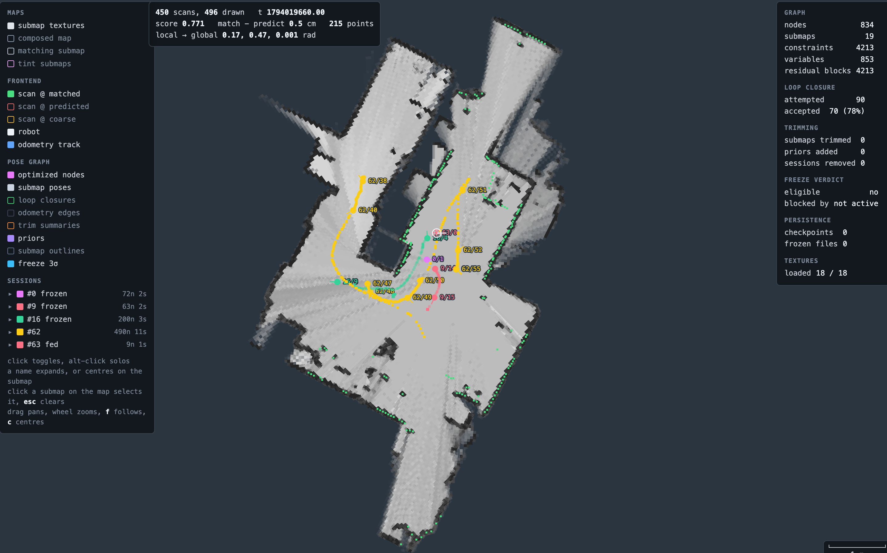
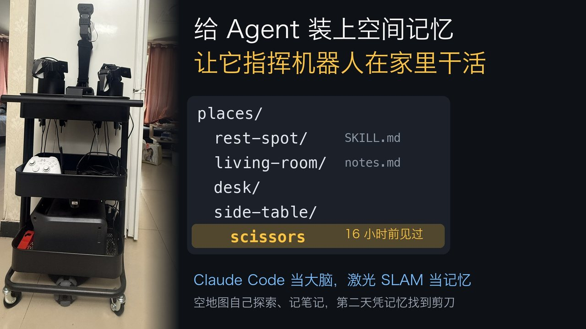

# EvergreenSLAM

EvergreenSLAM 是一个常驻、无需人工干预、Agent 友好的 2D 激光 SLAM 系统，适合作为 Agent 长期的空间记忆。

[](https://github.com/ThomasZB/EvergreenSLAM/actions/workflows/ci.yml)

[English](../README.md) | 中文

---

<https://github.com/user-attachments/assets/fbfdee89-250d-42ae-aad3-e9d3cb0cb1f4>

<p align="center"><sub>一个 agent（Claude Code）用 EvergreenSLAM 当家用机器人的记忆；1 分 44 秒，画面上标有当前时间和播放倍速。第一天从空地图开始：让它去阳台拍照，它凭探索时自己写下的一句笔记找到了阳台。第二天，机器人断电一夜后，一个没有对话历史的新会话凭记忆找到了剪刀。全程没有遥控，也没有任何手动建图、定位的操作。完整视频（3 分 18 秒）：<a href="https://www.bilibili.com/video/BV1M2xW6JEDT">B 站</a>（中文字幕）、<a href="https://youtu.be/FXoj2yCrbuo">YouTube</a>（英文字幕）；详见<a href="#完整探索流程演示">「实验」</a>。</sub></p>

## 功能

EvergreenSLAM 主要功能/特点如下：

- 常驻 Lifelong SLAM：自动创建、冻结、扩展地图，支持多次断电重启后继续使用，用户无需关心建图定位。
- CLI 工具：提供便捷的命令行接口，方便用户在终端中进行控制和调试。
- Agent 友好：提供 Agent Skill，MCP 接口，支持 Agent 直接调用 SLAM 功能。
- 地点保存：通过 CLI 可以保存地点，SLAM 内部自动处理地点对应的坐标，能够随着位姿图优化自动更新，用户无需关心地点坐标。
- 空间记忆系统：使用文件夹结构存储空间记忆，Agent 可以像读取普通记忆一样用 `grep`、`cat`、`ls` 等命令读取空间记忆。
- 可视化：提供可视化工具，方便用户查看地图和定位结果。
- 轻量/低成本：项目使用 C++ 编写，依赖少，编译简单，运行成本低，仅需要一颗200元左右的激光雷达配合一个低功耗的单板计算机即可运行。

想要了解 Lifelong SLAM 设计的可以看 [Lifelong SLAM 系统](#lifelong-slam-系统)。对 SLAM 不感兴趣的用户，可以直接跳到[Agent 空间记忆](#agent-空间记忆)章节，了解 EvergreenSLAM 是如何作为 Agent 的空间记忆系统。想要看实验效果的用户可以直接跳到[实验](#实验)章节，了解 EvergreenSLAM 在机器人中的实际应用。想要直接体验的用户可以直接跳到[编译与运行](#编译与运行)章节，快速上手。

## Lifelong SLAM 系统

<p align="center">
  
  <br>
  <sub><code>pixi run -e ros demo</code>：Cartographer 公开的 revo_lds 数据包（Neato 扫地机上的 Revo LDS 雷达，约 16 分钟）在浏览器调试视图中 8 倍速回放。session #0 和 #1 先后冻结，随后 #2 开始建图。</sub>
</p>

### 设计

Lifelong SLAM 已经是一个成熟的研究方向，SLAM 领域近几年有大量相关的论文，但缺少一个开源的、省心的、可直接使用的 2D 激光 Lifelong SLAM 系统。EvergreenSLAM 旨在填补这一空白。和大多数论文中提出的 Lifelong SLAM 系统一样，EvergreenSLAM 也有以下特点：

- 多 Session 管理：每次运行都是一个新的 Session/Trajectory，分为冻结 Session、空闲 Session 和当前 Session，冻结 Session 不可修改。
- 有界增长：系统会自动判断空闲 Session 和当前 Session 中子图的被覆盖率，当被覆盖率大于阈值时，子图会自动删除，避免地图无限增长。
- 保留历史信息：子图被删除时，为了保留历史信息，系统会进行边缘化，并用 Chow-Liu 树稀疏化，避免 fill-in。
- 位姿图优化：未冻结 Session 的位姿连同它们到冻结 Session 的约束一起优化，冻结位姿保持为常量。

为了保证系统的长期运行，EvergreenSLAM 还有一套自动的垃圾清理机制，没有和任何冻结 Session 建立约束的 Session 称为悬浮 Session；启动时，上次使用距今超过 5 次启动的悬浮 Session 会被自动删除（`gc_unfrozen_after_n_boots`，0 为关闭）。

>这套流程和逻辑参考了一些较为经典的 Lifelong SLAM 研究，例如：
>
>- [Information-theoretic compression of pose graphs for laser-based SLAM](https://dl.acm.org/doi/10.1177/0278364912455072)
>- [A General Framework for Lifelong Localization and Mapping in Changing Environment](https://arxiv.org/abs/2111.10946)
>
> 后续如果有时间，我会补充详细设计细节和系统框图，当前如果感兴趣可以直接看源码。

### 自动管理的“建图”、“定位”与“扩展”

<p align="center">
  
  <br>
  <sub>长时间运行时的浏览器调试视图：创建过 63 次 session，当前 5 个 session，其中 3 个已冻结。</sub>
</p>

除了 Lifelong SLAM 的特点，为了作为后台常驻程序，让用户无需关心建图和定位，EvergreenSLAM 制作了一套自动冻结和自动扩展地图的机制，当满足下面的条件时，EvergreenSLAM 会自动冻结当前地图并创建一个新的 Session：

- 第一张子图完成时：第一张子图坐标永远是（0,0,0），当第一张子图完成时，EvergreenSLAM 会自动冻结当前地图并创建一个新的 Session，作为后续冻结的参考 Session。
- 满足扩展条件：第一张子图完成后，后续的所有冻结都可以称为“地图扩展”，在已与冻结 Session 建立约束的前提下，满足如下条件时自动冻结：
  1. 新增面积大于旧地图面积的 10% 或新增面积大于 200 m²
  2. 连续 7 个子图没有新面积增长
  3. 每张已完成子图位姿的边缘标准差在各轴上低于阈值

需要说明的是，事实上 EvergreenSLAM 并没有提供传统意义上的“建图”、“扩展”和“定位”功能，而是提供了一个如上所述的自动管理机制。该机制用户可以直接使用，主要用于保证定位长期运行而不随着更新漂移，如果用户使用的环境是高动态，用户也可以通过修改 `auto_freeze` 参数关闭该功能，关闭后 EvergreenSLAM 就是一个典型的 Lifelong SLAM 系统，没有固定的锚点，地图可能会随着更新漂移，但保存的地点会自动随着位姿图一同漂移，用户仍无需担心无法回到保存的地点。

当然用户如果想让 Agent 或人工管理“建图”、“扩展”和“定位”，也有对应的接口：`egs session freeze` 手动冻结，`egs map new/open` 新建或切换地图，`egs init-pose`/`egs relocalize` 手动重定位，可以当作传统 SLAM 的建图、扩展和定位来用。

### 重定位

每次启动时，新 Session 从上次保存的位姿起步，靠回环自动对齐到冻结地图，用户无需手动重定位。

如果一直没有回环连上冻结地图，当前 Session 会以初始位姿为起点继续运行。用户可以通过调用 `egs relocalize` 命令来触发全图重定位，目前该接口会对所有冻结子图逐张做分支定界搜索，比较耗时，后续会提供更高效的重定位接口。

当然，用户也可以通过 `egs init-pose` 命令指定初始位姿来进行重定位，EvergreenSLAM 会在指定的初始位姿附近进行 2 米范围的分支定界搜索，速度会快很多。指定初始位姿后，内部会给最新的关键帧一个回环的初始值进行搜索，即使搜索没有产生回环，悬浮 Session 也会被整体移到得分最高的弱匹配上（没有就移到给定位姿），`egs` 把这种结果报告为 `reseeded`；已经连上冻结地图的 Session 不会被这样移动。

## Agent 空间记忆

有了上述的自动管理机制，EvergreenSLAM 可以作为一个常驻的 Agent 空间记忆系统。本项目设计了一套使用文件夹结构存储空间记忆的方案，所有的记忆都保存在 `memory/` 目录的普通文件下，Agent 通过 `egs fs ls|tree|cat|grep` 访问和管理（SLAM 跑在本机时也可以直接用 shell）。EvergreenSLAM 也提供了命令行工具和 Agent Skill 来方便地管理空间记忆，Agent 可以通过这些接口来保存地点、查询地点、观察地点等。主要特点如下：

- 地点即锚点：比如 `egs place save places/kitchen` 可以将机器人位姿保存成一个锚点，该锚点通过 ID 挂载在后端位姿图的子图上，位姿图重新优化、删减、冻结、重启之后，地点随子图一起移动，`egs where` 总是给出当前位置。
- 记忆即目录：目录是地点和物体，路径表示包含关系，例如 `places/kitchen/table/apple` 是厨房桌子上的苹果。需要 Agent 自己管理哪些适合保存为地点，哪些写到目录下的文件中。
- 地点即工作区：地点目录下可以放 `notes.md`（笔记）、`SKILL.md`（在这里该知道什么，比如怎么停靠）；物体有只追加的观察记录 `observations.jsonl`（看到、确认不在、没法确认）和照片附件。
- 方便的记忆检索：`egs fs ls|tree|cat|grep|write|mv|rm` 操作这棵目录树，`egs find 剪刀` 按名字、别名、类别找物体，`egs fs grep balcony` 搜索全部笔记。
- 通过 view 接口自检：提供 view 命令，Agent 或用户可以通过 view 命令查看当前地图和定位结果。view 接口支持传入参数，像 rviz 一样自定义要显示的内容。
- 命令与运行分离：`egs` 只依赖 Python 标准库，通过 HTTP 访问 SLAM 进程里的 agent 服务（`127.0.0.1:8643`），Agent 在另一台机器上时通过 SSH 隧道接入。只接工具、不接 shell 的 Agent 可以用 `egs mcp`（stdio MCP，工具与命令一一对应）。

具体命令可以查看 `egs help agent`（不到 30 行），目录约定见 [memory_README.md](../adapters/agent/memory_README.md)，Agent Skill 见 [SKILL.md](../adapters/agent/skills/evergreenslam/SKILL.md)，HTTP 接口见 [API.md](../adapters/agent/API.md)。

### CLI 工具

项目为了便于 Agent 使用，提供了一个命令行工具 `egs`，该 CLI 工具不仅可以给 Agent 使用，用户也可以非常方便地用它控制和调试 EvergreenSLAM 系统。一些常用的命令如下：

```bash
egs --help                        # 显示帮助信息
egs root                          # memory/ 的位置和当前地图
egs here                          # 机器人当前位姿
egs relocalize                    # 触发全图重定位
egs init-pose --place places/<p>  # 指定初始位姿进行重定位
egs map ls|new|open               # 地图管理，列出、新建、切换地图
```

## 实验

截至 2026 年 11 月 7 日，EvergreenSLAM 已经在我家的机器人中稳定运行了半个月，目前主要用于调试我的机器人 Harness，在调试过程中，Agent 每次都能精准地执行地点相关的任务，比如我调试时经常让 Agent 执行的命令：

- 去调试点
- 回到休息点
- 去充电的地方

这些任务很简单，普通的 SLAM 在构建完地图后，转为定位模式，保存站点坐标，Agent 通过调用工具也能完成。本系统的优势在于，部署 EvergreenSLAM 后 Agent 可以在没有任何人工干预的情况下，从初次开机，通过自然语言与 Agent 交互，仅在少量对话的情况下（例如“后面没什么任务就停在这里”），Agent 能够自己保存地点，无需传统的“建图-定位-保存站点”的流程，Agent 也无需关注 SLAM 细节，甚至 Agent 可以无需知道当前是否运行了 SLAM 系统，Agent 通过 egs 命令能够轻松地记住当前位姿，也不需要记住任何坐标，并在后续通过自然语言查询和处理。

>这套使用流程在机器人 Harness 中的记忆效果比我预期的好得多，比如我当前正在设计的机器人 Harness 中，有一个后台的 Worker 进程，负责地点记忆（具体为获取照片，通过 egs 记录有价值的内容）。在我家中，机器人能够自我探索，或者跟随我走一圈，然后在后续的对话中，Agent 能够通过自然语言查询和处理这些地点记忆，就像处理普通记忆一样自然。在一轮探索任务中，我没有告诉 Agent 任何地点名称，结束探索后，我让 Agent 去阳台拍照，Agent 首先通过 `egs find 阳台`，发现没有阳台这个地点，又通过 `egs fs grep balcony`，在 `places/living-room/notes.md` 第 7 行中找到了这个地点，保存的原文为 `a red striped curtain and, past it, a glass door to what looks like a balcony (阳台, inferred)`。egs 让 Agent 查询空间记忆和普通记忆一样简单自然，Agent 只需要记住一个关键词就可以了，Agent 不需要记住任何坐标，也不需要知道当前是否运行了 SLAM 系统。

### 完整探索流程演示

<p align="center">
  
  <br>
  <sub>演示所用的平台：一台 XLeRobot（三个全向轮、装在云台上的头部相机、两条 SO-101 机械臂，未使用），雷达与下面的小车相同，主控是一块 RK3588 板子。EvergreenSLAM 只用到其中的雷达和板子。</sub>
</p>

<p align="center">
  <a href="https://www.bilibili.com/video/BV1M2xW6JEDT"></a>
  <br>
  <sub>完整视频（3 分 18 秒，中文字幕），点击在 B 站观看；英文字幕版见 <a href="https://youtu.be/FXoj2yCrbuo">YouTube</a>。</sub>
</p>

**演示流程：**

1. 启动 EvergreenSLAM 系统，创建一个空白的新地图。
2. 在 RobbyBot 项目（我的另一个项目，当前未开源）中启动 Claude Code，模型 Opus 5.5，加载 Skill。
3. 让机器人跟着我，在冰箱侧面保存一个休息点。
4. 让机器人自由探索，Agent 通过 egs 命令保存了多个地点。
5. 让机器人去找剪刀，Agent 通过 egs 命令了解了刚刚保存的桌子、书架等地点，按照剪刀可能出现的地点依次进行检查，最终在桌子上找到了剪刀。
6. 让机器人去阳台拍照后回到休息点，Agent 通过 egs 命令找到了阳台，并拍照保存，然后回到了休息点。
7. 第二天重启机器人，让机器人去找剪刀，Agent 通过 egs 命令找到了剪刀在桌子上，去确认后回到休息点，并追加了一次观察记录。

> 本次实验中途，机器人多次通过 Telegram 发消息询问我，我让它自己去找，并提示了剪刀一般放在桌子上。在录制视频的前两次试验中，机器人没有询问，在一次对话中就找到了剪刀。

**Agent 控制过程**（时间为视频左上角显示的时间，只记 Agent 和 egs 之间发生了什么）：

1. **开始（17:03）**：`egs root`、`egs fs cat README.md`、`egs here`、`egs fs tree places`，确认是新地图，没有任何地点。
2. **休息点（17:03–17:06）**：`egs place save places/rest-spot`，再写 `node.yaml`（别名）和 `notes.md`，注明是人指定的。
3. **自由探索（17:06–17:12）**：从 `egs view map` 挑没去过的区域，到达后用相机观察，存下手办架、客厅、洗衣机、电脑桌、卧室等地点，笔记里注明信息来源（看到的、人说的、推断的）。17:08 客厅笔记里多了一句推断：窗帘后面的玻璃门看起来通往阳台。阳台没去过，也没有保存。
4. **自己写地点规则（17:13）**：回休息点时 Nav2 在最后几厘米来回蠕动，Agent 改为自己短距离收尾，并写了 `places/rest-spot/SKILL.md`（冰箱侧板正对身后，雷达后方读数 0.43–0.45 m）。之后 `egs where places/rest-spot` 都会提示先读它。
5. **找剪刀（17:12–17:23）**：`egs find 剪刀`、`egs fs grep scissors` 都没有结果。物体检测服务此时已掉线，Agent 改为自己看快照，依次排查电脑桌、工具架（存为 `tool-shelf`）、玄关和卧室的小桌，每处「没找到」都追加进对应的 `notes.md`；我提示「剪刀一般放在桌子上」后，这句被记进 `places/notes.md`。最后在一张探索时漏掉的小边桌上找到：`egs place save places/side-table`，`egs observe places/side-table/scissors --offset …`。
6. **去阳台拍照（17:23–17:25）**：`egs find 阳台` 没有结果，`egs fs grep balcony` 找到第 3 步那句推断。开到工具架，转头看窗帘，进去后存下 `places/balcony`（别名 阳台），发出照片。从听到请求到发出照片 102 秒，期间我没有再说话。
7. **回休息点（17:25–17:26）**：按自己写的 `SKILL.md` 收尾。
8. **第二天（09:39–09:43）**：断电过夜（机器人没有被搬动），开机后没有手动重定位，`egs here` 直接报告在 `places/rest-spot`。新会话没有任何对话历史：`egs find 剪刀` 返回 `places/side-table/scissors`（16 小时前看到），Agent 用 `egs where` 的接近位姿开过去核实，44 秒后发出照片，`egs observe` 追加一条新观察。回休息点仍按前一天的 `SKILL.md` 收尾。

第一天结束时 `memory/` 里有 12 个地点、1 个物体、1 条地点规则和 1 份全屋笔记，全部是普通文件。`egs` 只负责记忆：行驶由 Nav2 完成，听、看和所有决定由 Agent 借助 Harness 的工具完成；全程没有遥控。

### 更早的实验（超低成本平台）

<p align="center">
  
  <br>
  <sub>最早的测试平台：一颗 2D 雷达（215 元，约 30 美元），一块 RK3588 的 Orange Pi，麦轮，两个充电宝。</sub>
</p>

项目刚开始的时候，在老家搭建的一个超低成本的测试平台，完成了代码的部署和验证。保留在这里是为了说明项目能在低成本平台上快速部署和使用，这台车我已经不再使用。后续的实验都在上面展示的 XLeRobot 上进行。

## 编译与运行

只编 core，不需要 ROS：

```bash
cmake -S core -B build -DEVERGREENSLAM_BUILD_TESTS=ON && cmake --build build -j8 && ctest --test-dir build
```

依赖：Eigen、Ceres、glog、yaml-cpp、protobuf（库和 `protoc`）、OpenMP、gtest。

```bash
# macOS
brew install eigen ceres-solver glog yaml-cpp protobuf libomp googletest
# Ubuntu 24.04（core 链接 yaml-cpp 0.8，22.04 的包太旧）
sudo apt install libeigen3-dev libceres-dev libgoogle-glog-dev libyaml-cpp-dev \
                 libprotobuf-dev protobuf-compiler libgtest-dev
```

或者让 [pixi](https://pixi.sh) 把一切装好，包括 ROS 2 Jazzy 和 rviz2（macOS Apple Silicon 和 Linux；`pixi.toml` 头部列出了全部任务）：

```bash
pixi run core-test                      # 只有 core
pixi run agent-test                     # agent 服务和 egs
pixi run -e ros ros-test                # ROS 2 适配器
SCAN_TOPIC=/base_scan BASE_FRAME=base_footprint pixi run -e ros bag bags/wg_cafe   # 回放，浏览器视图在 http://localhost:8642
pixi run -e ros live                    # 实时节点：/scan 进，地图、tf 和 agent 服务出
pixi run -e ros demo                    # 下载 3 MB 的公开数据包，带浏览器视图和 egs 回放
```

`live` 需要一个雷达驱动往 `/scan` 发 `sensor_msgs/LaserScan`（`SCAN_TOPIC` 可改），以及 `base_link` 到雷达坐标系的 TF（两者不同时）。它总会用激光里程计发 `/odom`（不带协方差），开着 `publish_tf` 时还发 odom 到 base_link 和 map 到 odom 两个 TF；底盘驱动如果也发 odom 到 base_link，应关闭底盘那边的，因为 `publish_tf=false` 会把 map 到 odom 一起关掉；两个 `/odom` 话题也要 remap 掉一个。配置从 `configs/evergreenslam.yaml` 起步，museum 和 carmen 是给 museum 和 CARMEN 数据集用的。pixi 下地图存在 `runs/maps`（`MAP_ROOT` 可改；`bag` 只在设了 `MAP_ROOT` 时才落盘）。pixi 只配了 osx-arm64 和 linux-64；Linux ARM 板子上用系统包或 colcon。在 ROS 2 Jazzy 上测过。

仓库本身就是一个 colcon 工作空间源：放进任意 `ws/src`，然后 `rosdep install --from-paths src --ignore-src -y && colcon build`。Docker Compose 在 Linux 上封装了同样的目标（`docker compose run --rm core-test`）。

没有实时时钟（RTC）的板子上，节点应在时间同步之后启动：systemd unit 里写 `After=time-sync.target` 和 `Wants=time-sync.target`，并启用时间服务的等待单元（`chrony-wait.service` 或 `systemd-time-wait-sync.service`）。扫描时间戳倒退，或向前跳过 `max_scan_gap_seconds`（默认 60 s），都按时钟跳变处理：节点保存地图后以非零状态退出，重启时从上次保存的位姿重新对齐。因此需要配一个守护进程：systemd 的 `Restart=on-failure`，或 ROS 2 launch 的 `respawn`（`evergreenslam.launch.py` 已设置）。回放工具遇到同样情况会报错停止。

### 数据

仓库不带数据。公开的 2D 激光包大多是 ROS 1 的，两个脚本不装 ROS 也能转：

```bash
pip install rosbags
curl -O http://download.ros.org/data/graph_slam/wg-cafe.bag
python3 tools/convert_ros1_bag.py wg-cafe.bag bags/wg_cafe
SCAN_TOPIC=/base_scan BASE_FRAME=base_footprint EXTRA="--speed 4" pixi run -e ros bag bags/wg_cafe
```

开着浏览器视图时回放按真实时间走，`EXTRA="--speed 4"` 加速。回放时 agent 服务只在设了 `MAP_ROOT` 且加 `EXTRA="--agent_port 8643"` 时才开。

经典数据集（Intel Research Lab、ACES、MIT Killian Court）是 CARMEN 日志，在 [Freiburg SLAM evaluation 页面](http://ais.informatik.uni-freiburg.de/slamevaluation/datasets.php)；`tools/convert_carmen_log.py` 把 `.clf` 转成包。回放工具怎样对照参考轨迹打分，见 [`adapters/ros2/evergreenslam_ros/README.md`](../adapters/ros2/evergreenslam_ros/README.md)。

### agent 接口

实时节点跑起来后，agent 服务监听 `127.0.0.1:8643`，`egs` 是客户端：

```bash
export PATH="$PWD/adapters/agent/egs/bin:$PATH"
egs help agent                     # 规则和命令表，不到 30 行
egs here                           # 机器人在哪
egs status                         # 地图健康：冻结底图、对齐、回环
egs place save places/kitchen/door # 记住脚下这个位置
egs where places/kitchen/door      # 位姿、精度，以及接近它的位姿
egs view here                      # 扫描叠在地图上，机器人周围
```

`egs` 是 Python 3.9+，不依赖任何第三方库；`pipx install ./adapters/agent/egs` 可装在没有 ROS 的机器上，`egs skill install <skills 目录>` 给 agent 装 skill。skill 的第一节就是上手步骤（`egs root`，用 `egs fs cat` 读 `memory/README.md`，读到该地点为止的 `SKILL.md` 链）。只接工具、不接 shell 的 agent 可用 `egs mcp`：它以 stdio MCP 服务提供同一组命令，工具由 CLI 定义自动生成，与命令一一对应。服务只绑 `127.0.0.1`；agent 在另一台机器上时经 SSH 隧道访问（`ssh -NT -L 127.0.0.1:8643:127.0.0.1:8643 user@robot`），连接设置写在 `~/.config/egs/config`（见 [`adapters/agent/egs/README.md`](../adapters/agent/egs/README.md)）。HTTP 契约见 [`adapters/agent/API.md`](../adapters/agent/API.md)，skill 是 [`adapters/agent/skills/evergreenslam/SKILL.md`](../adapters/agent/skills/evergreenslam/SKILL.md)。

### 目录

```
core/            SLAM 本体，无 ROS：sensor / mapping / lifelong（位姿图、session、持久化）/ utils
adapters/ros2/   三个 ament 包：msgs、节点与回放工具、rviz2 插件
adapters/agent/  agent 服务（HTTP）、egs CLI 和 agent skill
apps/webui/      浏览器调试视图
configs/         yaml 配置；configs/reference.yaml 列出全部键
tools/           包转换脚本、TSan 门禁和 demo
```

## 相关工作与致谢

- [Cartographer](https://github.com/cartographer-project/cartographer)（Hess 等，2016；Apache 2.0）。相关性扫描匹配器、预计算栅格、概率栅格子图、体素和运动滤波、约束构建器沿用它的设计，rviz2 的子图显示移植自 `cartographer_rviz`。见 `NOTICE`。`core/src/utils/scan_matching` 离原版最近。Cartographer 没有 session、冻结和带边缘化的删减，这些由本项目实现。
- [slam_toolbox](https://github.com/SteveMacenski/slam_toolbox)（Macenski 与 Jambrecic，2021），Nav2 支持的 2D 激光 SLAM。它的模式由用户通过节点和配置选择：建图（同步或异步）、在序列化的位姿图上继续建图，以及用最近扫描的滚动窗口在序列化的位姿图上定位；另有一个实验性节点，可通过服务调用在建图和定位之间切换。删除节点的地方有两处，都经过 `Mapper::RemoveNodeFromGraph`，它把节点连同它的边一起删掉，不做边缘化：定位模式删除自己过期的扫描；`src/experimental/` 下的 lifelong 节点（其 README 称之为高度实验性）按每帧新扫描给附近的地图节点打分，删掉低分节点。它要求 TF 中有 odom 到 base 的变换：没有这个变换的扫描会被丢弃，最小移动距离的判断也在这个坐标系里做。EvergreenSLAM 不区分建图与定位，自行决定 session 何时冻结，删减时做边缘化，也不需要里程计输入。slam_toolbox 的扫描匹配器来自 Karto，其 README 称 Karto 的改进版本在世界各地的公司中使用；此外它还有 Nav2 集成、多机建图、地图合并和 rviz 中的交互式图编辑。以上对照的是其 `ros2` 分支的 6efdc33 提交（2026-10-15）。
- 删减中的边缘化和 Chow-Liu 稀疏化沿用位姿图压缩方向的文献，思路与 Kretzschmar 和 Stachniss（2012）相同。
- [Claude Code](https://claude.com/claude-code)。大部分代码是用 Claude 写的，设计、审查和测试由作者完成。
- [cpp-httplib](https://github.com/yhirose/cpp-httplib)（MIT）和 [stb_image_write](https://github.com/nothings/stb)（公有领域），放在 `third_party/`。
- [RoboStack](https://robostack.github.io/)，它把 ROS 2 装进了 pixi，macOS 上的开发流程依赖它。
- Freiburg 和 Willow Garage 的数据集，回放和打分用的是它们；Cartographer 的 revo_lds 数据包，demo 用的是它。

## 引用

如果本项目对你的工作有帮助，欢迎引用。GitHub 仓库页右侧的 “Cite this repository” 读取的是根目录的 [`CITATION.cff`](../CITATION.cff)。

```bibtex
@software{chen2026evergreenslam,
  author  = {Chen, Hang},
  title   = {EvergreenSLAM: always-on 2D lidar SLAM as the long-term spatial memory of an agent},
  year    = {2026},
  version = {0.3-preview},
  url     = {https://github.com/ThomasZB/EvergreenSLAM}
}
```

## 许可

Apache License 2.0，见 [`LICENSE`](../LICENSE) 和 [`NOTICE`](../NOTICE)。
